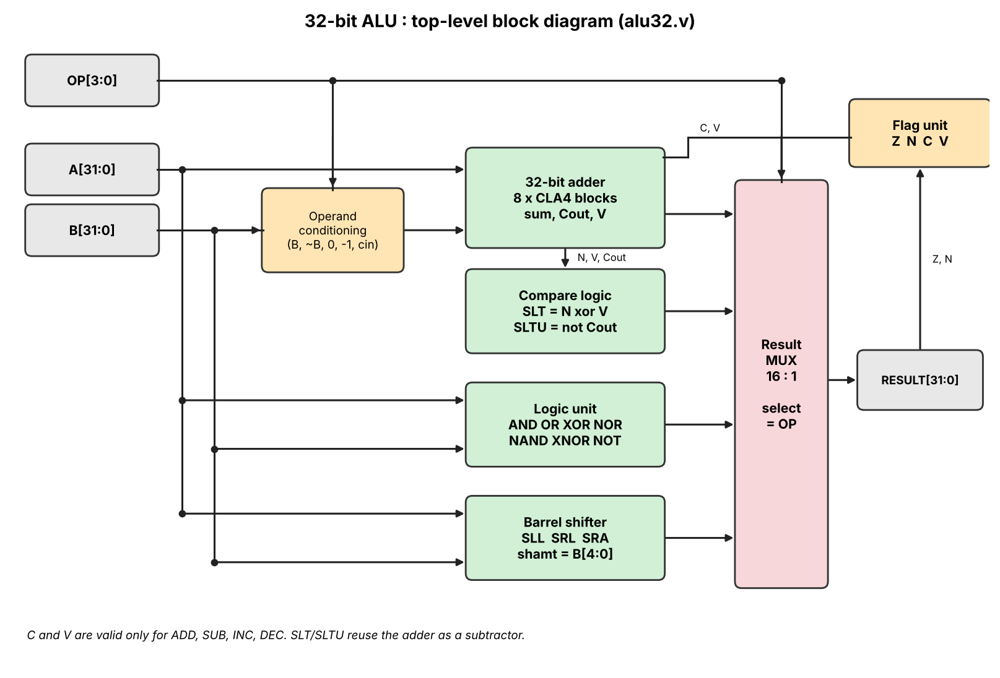
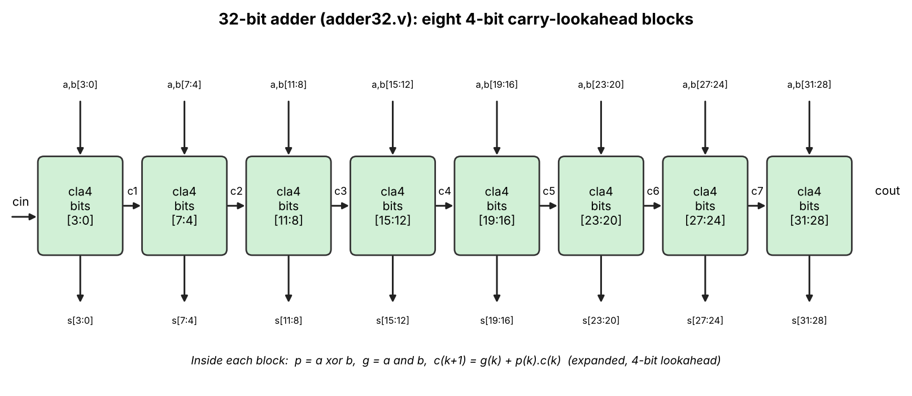
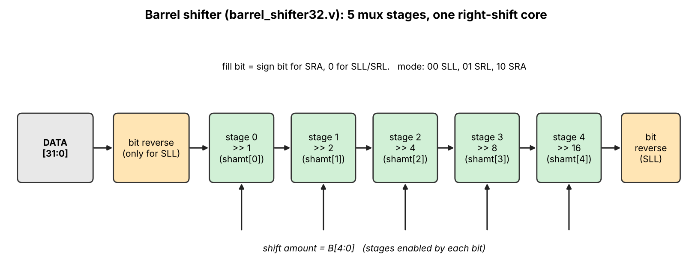

# Design and Implementation of a 32-bit Arithmetic Logic Unit (ALU) using Verilog

A combinational 32-bit ALU with 16 operations and four status flags (Zero, Negative, Carry, Overflow). The adder is built structurally from eight 4-bit carry-lookahead (CLA) blocks, shifts use a 5-stage barrel shifter, and the compare instructions (`SLT`, `SLTU`) re-use the subtractor. Everything is written in **Verilog-2005**, verified with self-checking testbenches in Icarus Verilog, and comes with Yosys scripts for generic and Lattice ECP5 synthesis.

|                  |                                                                                         |
| ---------------- | --------------------------------------------------------------------------------------- |
| **Submitted by** | Mohammad Irtiqa Bhat (2024-25MECECS005)<br>Mohammad Abbas (2025MECECS002)               |
| **Submitted to** | [DR afshan Amin]                                                                       |
| **Department**   | Department of Electronics and Communication Engineering, National Institute of Technology Srinagar |



## 1. Project files

| File                                      | Type            | Purpose                                                                                     |
| ----------------------------------------- | --------------- | ------------------------------------------------------------------------------------------- |
| `rtl/alu32.v`                             | **Top module**  | Operand conditioning, result multiplexer, compare logic, flag generation                    |
| `rtl/adder32.v`                           | Sub-module      | 32-bit adder made of eight `cla4` carry-lookahead blocks (`cla4` is defined in this file)   |
| `rtl/barrel_shifter32.v`                  | Sub-module      | 5-stage barrel shifter for SLL / SRL / SRA                                                  |
| `tb/tb_alu32.v`                           | **Testbench**   | Self-checking system testbench: reference model, directed + random tests, golden vectors, coverage |
| `tb/tb_adder32.v`                         | Testbench       | Unit test: exhaustive `cla4` (512 cases) and 20,000 random 32-bit additions                 |
| `tb/tb_barrel_shifter32.v`                | Testbench       | Unit test: every shift amount and mode, plus random data                                    |
| `tb/vectors.mem`                          | Test data       | 3,100 golden vectors (op, a, b, expected result, expected flags) from the Python model      |
| `sw/ref_model.py`                         | Software        | Python reference model, bit-level emulation of the RTL structure, and vector generator      |
| `run_sim.sh` / `run_sim.bat`              | Script          | Compile and run all three testbenches (Linux/macOS / Windows)                               |
| `synth/synth_generic.ys`, `synth_ecp5.ys` | Synthesis       | Yosys scripts: generic gate-level and Lattice ECP5 synthesis                                |
| `run_synth.sh`                            | Script          | Runs both synthesis flows and prints the statistics                                         |
| `docs/figures/`, `docs/make_figures.py`   | Documentation   | Block diagrams used in this README and the script that draws them                           |
| `report/report.pdf`, `report/report.tex`  | Report          | Project report (LaTeX source and PDF). Insert your simulation screenshots in Section 6 and recompile with `pdflatex report.tex` |
| `sim/`                                    | Results         | Logs (`*_sim.log`) and the waveform `alu32.vcd` appear here after running `run_sim`         |

## 2. Theory

### 2.1 What an ALU does
The ALU is the part of a processor that performs arithmetic and logic on binary operands. It takes two operands `A` and `B`, an operation code `OP`, and produces a result plus status flags that tell the control logic what happened (zero result, negative, carry, overflow).

### 2.2 Two's complement arithmetic
Signed numbers use two's complement, so one adder handles both signed and unsigned values. Subtraction is done as `A - B = A + ~B + 1`. For signed numbers the range is -2^31 to 2^31-1.

### 2.3 Carry-lookahead addition
A ripple-carry adder waits for each carry in turn, so its delay grows with the word length. A carry-lookahead block computes carries directly from the *propagate* `p = a xor b` and *generate* `g = a and b` signals:

```
c1 = g0 + p0·c0
c2 = g1 + p1·g0 + p1·p0·c0
c3 = g2 + p2·g1 + p2·p1·g0 + p2·p1·p0·c0
c4 = g3 + p3·g2 + p3·p2·g1 + p3·p2·p1·g0 + p3·p2·p1·p0·c0
sum_i = p_i xor c_i
```

This design uses eight 4-bit CLA blocks (`cla4`). Inside a block the carries are fully looked ahead; between blocks the carry ripples. This is a common area/speed compromise.



### 2.4 Status flags
| Flag | Meaning | Equation |
| ---- | ------- | -------- |
| Z | result is zero | `result == 0` |
| N | result is negative | `result[31]` |
| C | carry out of the adder (for SUB/DEC, **C = 1 means no borrow**, ARM convention) | `Cout` |
| V | signed overflow | operands have the same sign but the result sign differs |

`C` and `V` are only defined for `ADD`, `SUB`, `INC`, `DEC`; they are 0 for all other operations.

### 2.5 Comparison without a comparator
`SLT` and `SLTU` run the adder as `A + ~B + 1`:
- **Signed** `A < B` is true when `N xor V` is 1.
- **Unsigned** `A < B` is true when there is a borrow, i.e. `Cout = 0`.

### 2.6 Barrel shifter
A barrel shifter shifts by any amount from 0 to 31 in one pass using five 2:1 mux stages (shift by 1, 2, 4, 8, 16). Only a right-shifter is built. For `SLL` the input and output bits are reversed, so one core serves all three shifts. `SRA` fills with the sign bit.



## 3. Operation set

| OP   | Mnemonic | Operation                         | Flags valid        |
| ---- | -------- | --------------------------------- | ------------------ |
| 0000 | `ADD`    | A + B                             | Z N C V            |
| 0001 | `SUB`    | A - B                             | Z N C V            |
| 0010 | `AND`    | A & B                             | Z N                |
| 0011 | `OR`     | A \| B                            | Z N                |
| 0100 | `XOR`    | A ^ B                             | Z N                |
| 0101 | `NOR`    | ~(A \| B)                         | Z N                |
| 0110 | `NAND`   | ~(A & B)                          | Z N                |
| 0111 | `XNOR`   | ~(A ^ B)                          | Z N                |
| 1000 | `SLL`    | A << B[4:0]                       | Z N                |
| 1001 | `SRL`    | A >> B[4:0] (zero fill)           | Z N                |
| 1010 | `SRA`    | A >>> B[4:0] (sign fill)          | Z N                |
| 1011 | `SLT`    | 1 if A < B, signed, else 0        | Z N                |
| 1100 | `SLTU`   | 1 if A < B, unsigned, else 0      | Z N                |
| 1101 | `INC`    | A + 1                             | Z N C V            |
| 1110 | `DEC`    | A - 1                             | Z N C V            |
| 1111 | `NOT`    | ~A                                | Z N                |

## 4. Micro-architecture

The ALU is purely combinational (no clock).

- **Operand conditioning:** a small mux feeds the adder `B`, `~B`, `0` or `0xFFFFFFFF` with the matching carry-in, so one adder serves `ADD`, `SUB`, `INC`, `DEC`, `SLT` and `SLTU`.
- **Functional units:** adder, logic unit, barrel shifter and compare logic work in parallel.
- **Result mux:** a 16:1 multiplexer driven by `OP` selects the result.
- **Flag unit:** `Z` and `N` come from the result; `C` and `V` come from the adder and are masked to 0 unless the operation is `ADD`, `SUB`, `INC` or `DEC`.
- **Ports:** `a[31:0]`, `b[31:0]`, `op[3:0]` in; `result[31:0]`, `zero`, `negative`, `carry`, `overflow` out.

## 5. Verification

### 5.1 Method
`tb_alu32` is a **reference model + checker** testbench. The reference model inside the testbench is written differently from the RTL on purpose:
- it uses the simulator's `+`, `-`, `<<`, `>>`, `>>>` and `<` operators instead of CLA and mux stages;
- it finds signed overflow by comparing bits [33] and [32] of a 34-bit sign-extended result, not with the sign-of-operands rule used in the RTL.

A second, independent check comes from `sw/ref_model.py`, which produces `tb/vectors.mem`. The testbench compares result **and** all four flags for every vector.

### 5.2 Test plan

| #  | Test                     | What it checks                                                                      |
| -- | ------------------------ | ----------------------------------------------------------------------------------- |
| T1 | Known answers            | 10+20, 50-20, carry out, signed overflow, borrow, signed vs unsigned compare, SRA   |
| T2 | Corner x corner          | all 16 operations on every pair of 8 corner values (0, 1, -1, INT_MAX, INT_MIN, patterns) |
| T3 | All shift amounts        | SLL / SRL / SRA for shift 0..31, and upper bits of `B` being ignored                |
| T4 | Constrained random       | 20,000 random operations, 25% of operands biased to corner values                   |
| T5 | Golden vectors           | 3,100 vectors from the Python model (corner and random)                             |
| U1 | `cla4` exhaustive        | all 512 combinations of 4-bit a, b, carry-in                                        |
| U2 | `adder32` random         | carry ripples across all 8 blocks; 20,000 random additions                          |
| U3 | `barrel_shifter32`       | every shift amount and mode on several patterns, plus random data                   |

### 5.3 Results

**Python cross-check (run during development, `python sw/ref_model.py`):** the plain-integer model and the bit-level emulation of this RTL structure (CLA4 chain, 5-stage shifter, `N xor V` compare, flag masking) agree on all 3,100 golden vectors and on 200,000 further random vectors, with 0 mismatches.

**Simulation:** run `sh run_sim.sh` (or `run_sim.bat`). The logs are saved in `sim/`. When everything passes, each testbench ends with:

```
>>> ALL TESTS PASSED <<<
```

and `tb_alu32` also prints a per-opcode coverage line plus `errors : 0`.

## 6. Synthesis (optional)

```
pip install yowasp-yosys          # or use OSS CAD Suite
YOSYS=yowasp-yosys sh run_synth.sh
```

`synth_generic.ys` maps the flattened design to 2-input gates and prints cell counts. `synth_ecp5.ys` maps it to Lattice ECP5 LUTs. Statistics are written to `synth/reports/`.

## 7. How to run

1. Install [Icarus Verilog](https://bleyer.org/icarus/) (`winget install Icarus.Verilog` on Windows, `sudo apt install iverilog gtkwave` on Ubuntu).
2. From the project folder, run:
   - Linux / macOS: `sh run_sim.sh`
   - Windows: `run_sim.bat`
3. Open the waveform with `gtkwave sim/alu32.vcd`. Useful signals: `a`, `b`, `op`, `result`, `zero`, `negative`, `carry`, `overflow`.

Manual compile:

```
iverilog -g2005 -Wall -o sim/alu_tb.vvp rtl/adder32.v rtl/barrel_shifter32.v rtl/alu32.v tb/tb_alu32.v
vvp sim/alu_tb.vvp
```

The code is plain Verilog-2005 with no vendor primitives, so it also runs in ModelSim/Questa, Vivado XSim or EDA Playground.

To regenerate the test vectors or the diagrams:

```
python sw/ref_model.py
python docs/make_figures.py        # needs matplotlib
```

## 8. References

1. M. M. Mano and M. D. Ciletti, *Digital Design: With an Introduction to the Verilog HDL*, 5th ed., Pearson, 2013.
2. B. Parhami, *Computer Arithmetic: Algorithms and Hardware Designs*, 2nd ed., Oxford University Press, 2010.
3. D. A. Patterson and J. L. Hennessy, *Computer Organization and Design RISC-V Edition*, 2nd ed., Morgan Kaufmann, 2020.
4. *IEEE Standard for Verilog Hardware Description Language*, IEEE Std 1364-2005.
5. C. Wolf, *Yosys Open SYnthesis Suite*, https://yosyshq.net/yosys/
